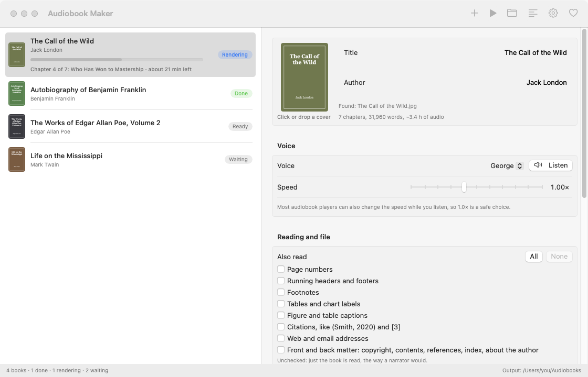
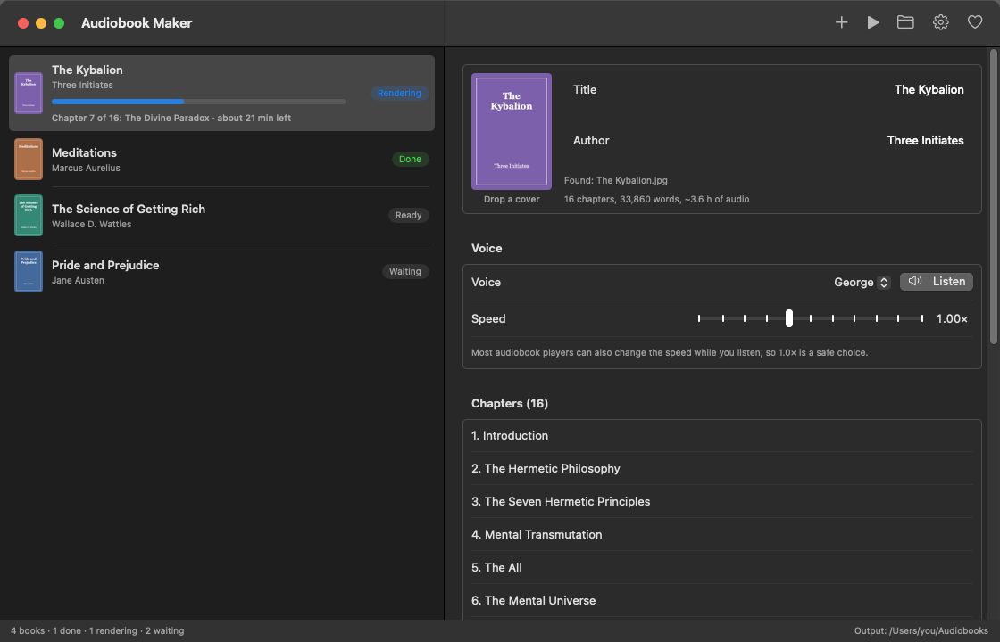
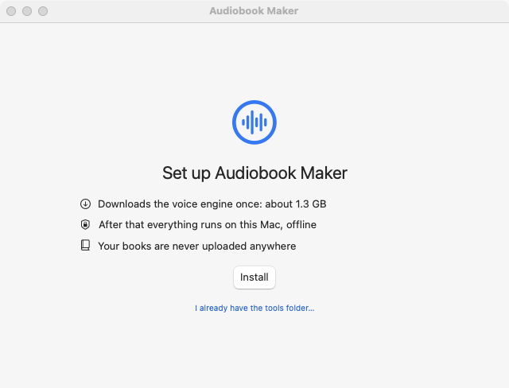
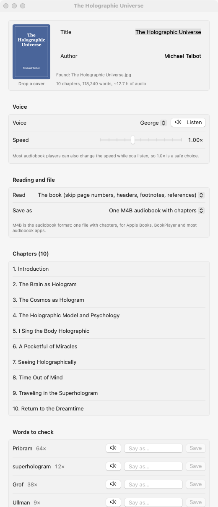
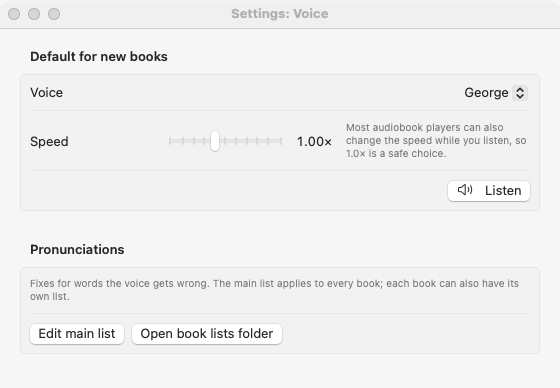
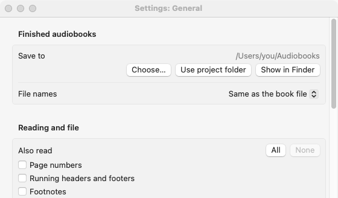
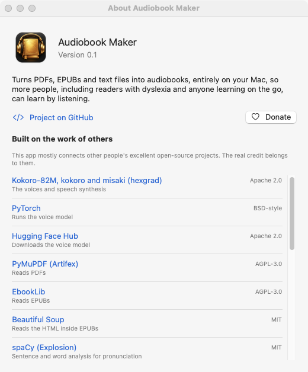
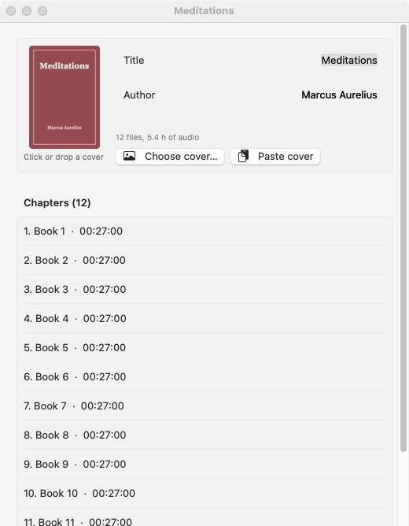

# Audiobook Maker: PDF / EPUB → Audiobook for Mac (local, offline)

A free, open-source Mac app and command-line tool that turns PDFs, EPUBs and text files into audiobooks: chaptered `.m4b` files (or MP3s) with covers, read aloud by natural-sounding [Kokoro-82M](https://huggingface.co/hexgrad/Kokoro-82M) text-to-speech voices.
Nothing leaves the machine after the one-time model download (~330 MB). Listen in Apple Books, BookPlayer or any audiobook player on your phone.

**Why:** to help people take in knowledge by listening instead of reading, especially people with dyslexia, and anyone who learns best on the go: walking, driving, working with their hands. Any book or paper you have can become an audiobook, privately and for free.

On an M1 Pro it runs at about **5.5× realtime** on CPU, so a 6.6-hour book takes about 72 minutes.

## Download the Mac app

**[Audiobook Maker for Mac: latest release](https://github.com/TechnAudioToolz/pdf-epub-to-audiobook/releases/latest)** (early preview)

- Needs **macOS 13 Ventura or newer** on a Mac with **Apple Silicon** (M1 or later).
- Open the `.dmg` and drag **Audiobook Maker** to Applications.
- The app isn't registered with Apple, so the first time macOS blocks it: go to **System Settings → Privacy and Security** and click **Open Anyway**. You only do this once.
- The download (about 700 MB) has everything inside: Python, the libraries and all 28 English voices. The one-time setup on first launch takes seconds, needs no internet, and uses about 1.3 GB of disk space. Your books never leave your Mac.

Drag in PDFs, EPUBs or text files, check the chapters, pick one of 28 voices, fix any mispronounced words, and render a queue of audiobooks with chapters and covers. Already have an audiobook as a folder of MP3s? Drop it in the **MP3 audiobooks → M4B** box and it becomes one M4B, one chapter per file. Everything below is the command-line version of the same tools.



| | |
|---|---|
|  **Dark mode** |  **First launch:** a one-time setup |
|  **Book panel:** chapters and words to check |  **Settings:** voice, speed and pronunciation lists |
|  **Settings:** where audiobooks are saved |  **About:** credits for every project it builds on |
|  **MP3 → M4B:** a folder of MP3s, one chapter per file | |

*Screenshots use public-domain books with generated covers. They're made by the app itself: `open "app/build/Audiobook Maker.app" --args -screenshots docs/screenshots`.*

## Free books to try

Public-domain books are free to download, convert and share. These libraries are good places to start:

| Library | What's there | Best format for this app |
|---|---|---|
| [Project Gutenberg](https://www.gutenberg.org) | The biggest free library: 70,000+ classics, no account needed | **EPUB** ("EPUB3 (E-readers incl. Send-to-Kindle)") |
| [Standard Ebooks](https://standardebooks.org) | A smaller set of classics, carefully proofread and formatted, with good covers | **EPUB** (the cleanest results) |
| [Internet Archive](https://archive.org/details/texts) | Millions of scanned books, including rare and out-of-print ones | **PDF**; scans are read with the Mac's text recognition |
| [Wikisource](https://wikisource.org) | Volunteer-transcribed texts, including historical documents and many languages | **EPUB** (the "Download" link on each work) |
| [HathiTrust](https://www.hathitrust.org) | Research-library scans; "Full view" books are public domain | **PDF** (scans) |
| [Faded Page](https://www.fadedpage.com) | Books that are public domain in Canada, proofread by volunteers | **EPUB** (check it's public domain where you live) |
| [Internet Sacred Text Archive](https://sacred-texts.com) | 1,200+ texts on religion, mythology, folklore and the esoteric | Pages are HTML: save the text, or find the same title on Gutenberg or the Internet Archive |
| [LibriVox](https://librivox.org) | Free *human-read* audiobooks of public-domain books | Already MP3s: drop the folder in the **MP3 audiobooks → M4B** box for one chaptered M4B |

Tips:
- **Pick EPUB when you can.** It has real chapters and clean text, so it converts best. PDFs work too; scanned PDFs take a few extra minutes for text recognition.
- **"Public domain" depends on the country.** A book that's free in Canada may still be under copyright in the US, and the other way round. These sites say where their books are free.
- **Rare texts:** the Internet Archive and HathiTrust are the places for old and unusual books that were never reprinted.

## Install the command-line tools (macOS, Apple Silicon)

```bash
git clone https://github.com/TechnAudioToolz/pdf-epub-to-audiobook.git && cd pdf-epub-to-audiobook
./setup.sh    # installs python@3.12, ffmpeg, espeak-ng via Homebrew, then a .venv with pinned deps
```

## Usage

```bash
# 1. Check chapters and the cleaned text first (fast, no audio)
.venv/bin/python audiobook.py book.pdf --dry-run

# 2. Render a 1-chapter preview to check the voice
.venv/bin/python audiobook.py book.pdf --chapters 2 --voice bm_george

# 3. Render the whole book (resumable: Ctrl-C and rerun picks up where it stopped)
.venv/bin/python audiobook.py book.pdf
```

Everything is written inside this project folder, wherever the input file lives. The input is only read.

- The finished book goes to `output/<Author> - <Title>.m4b` (or `output/<file name>.m4b` with `--name-from-file`).
- Working files go to `work/<book>/`: per-chapter WAVs cached per voice, `cleaned.txt`, chapter metadata and `render.log`. Once you're happy with the result, move that folder to the Trash.

## Converting many books (queue)

Give it several files, a whole folder, or both. Books render one after another:

```bash
.venv/bin/python audiobook.py "/path/to/My Books/" --name-from-file
.venv/bin/python audiobook.py book1.pdf book2.epub "/path/to/More Books/"
```

- **Covers are found automatically**, in this order: `covers/<book file name>.jpg|png|webp` in this project, then an image next to the book (`<book>.jpg`, `<book>-Cover.jpg`, `cover.jpg` or `folder.jpg`), then the book's own cover: an EPUB's cover image, or the first of a PDF's opening pages that looks like a cover (mostly a picture, few words). If there's none, a plain square cover is **generated** from the title and author.
- **Finished books are skipped**, so re-running a folder only converts the new ones. `--force` redoes them. Interrupted books resume from the last finished chapter.
- **One bad file doesn't stop the queue.** It's marked FAILED in the summary at the end.
- **A Mac notification** appears as each book finishes (`--no-notify` turns it off).
- **Watch progress** with `./status.sh`, or `tail -f work/<book>/render.log`.

Long queues can run for hours. To keep one going after you close the terminal, start it detached and keep the Mac awake:

```bash
nohup caffeinate -i .venv/bin/python audiobook.py "/path/to/My Books/" --name-from-file > queue.log 2>&1 &
```

## Options

| Flag | Meaning |
|---|---|
| `--voice` | `af_alloy` (default, US female), `af_heart`, `af_bella`, `am_michael`, `am_fenrir`, `bf_emma`, `bf_isabella`, `bm_george`, `bm_lewis`, ... Blend two voices with `af_heart,bm_george` |
| `--speed` | `0.9` slower, `1.15` faster |
| `--chapters` | Render only some chapters, e.g. `1-3,7`. Output is `*.preview.m4b` |
| `--fiction` | Turn off the academic cleanup (citation and abbreviation rewriting, footnote and caption removal) |
| `--name-from-file` | Name each output after its input file |
| `--force` | Redo books whose output already exists |
| `--cover` | Cover image (single book only; queues find covers automatically) |
| `--cover-choices N` | Write the first N pages to `work/<book>/cover-choices/` to pick from (the app's cover picker) |
| `--generate-cover` | Write a cover generated from the title and author to the same folder |
| `--title`, `--author`, `-o` | Override bad metadata or the output path (single book only) |
| `--list-unknown` | List the words Kokoro has to guess, then stop |
| `--keep LIST` | Also read things the cleanup skips, comma-separated: `page-numbers`, `headers`, `footnotes`, `tables`, `captions`, `citations`, `links`, `extras` (copyright, contents, references, index, about the author). In the app these are the **Also read** checkboxes |
| `--read-all` | Read everything on the page (all of `--keep`) |
| `--format mp3` | A folder with one numbered MP3 per chapter (tagged, with cover) instead of one M4B |
| `--no-chapters` | One continuous file without chapter markers (or a single MP3), for books whose chapters aren't found well. In the app: **One file, no chapter markers** above the chapter list |
| `--bitrate` | Audio bitrate, default `64k` (mono speech) |

## What the cleanup does (PDF)

- Uses the PDF's bookmarks for chapters. Without bookmarks it falls back to large or bold headings.
- Removes running headers and footers, page numbers, footnotes (small text at the bottom of the page), superscript markers, tables, and figure/table captions.
- Reads two-column layouts left column first, then right.
- Joins paragraphs split across pages and words hyphenated across lines.
- Strips citations such as `[3, 5–7]` and `(Smith et al., 2020)`, plus URLs and emails.
- Expands abbreviations: `e.g.` → "for example", `i.e.` → "that is", `Fig.` → "Figure", `et al.` → "and colleagues".
- Skips References, Bibliography, Index, Contents, Acknowledgments and Appendices.

Always skim `work/<book>/cleaned.txt` after a `--dry-run`. It contains exactly what will be spoken.

## Limits

- **Scanned PDFs** (pages that are pictures) are read with the Mac's built-in text recognition (the Live Text engine in Apple's Vision framework), offline, with nothing to install. The first time takes a few minutes for a whole book (about 1–3 pages a second) and the result is saved in `work/<book>/`. Recognition skips text it's unsure of (diagrams, handwriting) and can still produce odd words, so check **Words to check**. For the command line, build the tool once: `swiftc -O app/ocr.swift -o bin/ocr` (`app/build.sh` does this too).
- **Math and equations** come out garbled. Kokoro can't read LaTeX-style math.
- The Apple GPU (MPS) backend crashes on long sentences in PyTorch, so synthesis runs on CPU.

## Picking a voice

```bash
.venv/bin/python voices.py                                   # all 28 English voices
.venv/bin/python voices.py --text "A line from your book."   # your own test sentence
```

This writes `voice_samples/index.html`, a page with a player for each voice. It also writes `voice_samples/all_voices.m4b`, which has one chapter per voice, so you can skip chapters in Apple Books or BookPlayer to compare voices.

## Existing MP3 audiobook → chaptered M4B

**A folder of MP3s** (one file per chapter or part, even split into `Disc 1/`, `Disc 2/` folders) becomes one M4B with a chapter per file:

```bash
.venv/bin/python audio2m4b.py join "My Audiobook/" --check     # list chapters, title, author and cover first
.venv/bin/python audio2m4b.py join "My Audiobook/" [--cover cover.jpg] [--title ..] [--author ..]
```

Files are joined in name order ("Part 2" before "Part 10"). Chapter names come from the files' title tags, or their file names. The title and author come from the tags or the folder name ("Author - Title"). The cover is `--cover`, else a picture inside the MP3s, else `cover.jpg` / `folder.jpg` in the folder, else a generated one. Each file is converted once and cached, so a stopped job picks up where it left off. In the app, this is the **MP3 audiobooks → M4B** box under the books. Each job's panel lists its files by full name: add more (button, or drop them on the list or on the job), reorder them (drag, or the arrows), remove them, or sort by name; the chapters follow that order.

**A single long MP3:** `audio2m4b.py` converts an audiobook you already have, for example a single 14-hour MP3, into an M4B with real chapter markers. It finds the chapters itself, fully offline:

```bash
# 1. Find chapters. It listens to the pause before each chapter with a local Whisper model.
#    --toc (optional) takes exact titles from the book's PDF/EPUB bookmarks.
.venv/bin/python audio2m4b.py detect book.mp3 --toc book.pdf

# 2. Check work/<book>/chapters.tsv. Each line is "HH:MM:SS.mmm<TAB>Title". Fix or add lines as needed.

# 3. Build
.venv/bin/python audio2m4b.py build book.mp3 --cover cover.jpg --narrator "Name"
```

Chapter breaks in commercial audiobooks are about 3 s pauses where the narrator says "Chapter N …". With `--toc`, the tool lines the book's table of contents up against every pause in order. It tolerates Whisper misspelling unusual names, so it can match a title like "Kether" even when Whisper hears "chatter". It also reports any chapter it couldn't place, so you know what to check.

## Acknowledgements

This project mostly connects other people's excellent open-source work. The real credit belongs to:

| Project | What it does here | License |
|---|---|---|
| [Kokoro-82M](https://huggingface.co/hexgrad/Kokoro-82M), [kokoro](https://github.com/hexgrad/kokoro) and [misaki](https://github.com/hexgrad/misaki) by hexgrad | The voices and speech synthesis | Apache 2.0 |
| [PyTorch](https://pytorch.org) | Runs the voice model | BSD-style |
| [faster-whisper](https://github.com/SYSTRAN/faster-whisper) (SYSTRAN), using OpenAI's [Whisper](https://github.com/openai/whisper) models | Hears chapter titles in existing audiobooks | MIT |
| [PyMuPDF](https://github.com/pymupdf/PyMuPDF) (Artifex) | Reads PDFs | AGPL-3.0 |
| [EbookLib](https://github.com/aerkalov/ebooklib) | Reads EPUBs | AGPL-3.0 |
| [Beautiful Soup](https://www.crummy.com/software/BeautifulSoup/) | Parses EPUB HTML | MIT |
| [spaCy](https://spacy.io) (Explosion) | Sentence and word analysis for pronunciation | MIT |
| [eSpeak NG](https://github.com/espeak-ng/espeak-ng) and [phonemizer](https://github.com/bootphon/phonemizer) | Pronunciation of unusual words | GPL-3.0 |
| [FFmpeg](https://ffmpeg.org) | Audio encoding, chapters, cover art | LGPL/GPL |
| [NumPy](https://numpy.org), [soundfile](https://github.com/bastibe/python-soundfile) | Audio data handling | BSD |

Written with the help of [Claude](https://claude.com/claude-code) (Anthropic).

If this project helps you, please consider supporting the projects above as well.

## Fixing pronunciations

Names like *Kether*, *Malkuth* or *Enoch* sometimes come out wrong. Fix them once in `pronunciations.txt` and the fix applies to every book:

```text
Enoch = /ˈinɪk/          # exact phonemes (most reliable)
Qliphoth = Klip-oth      # or a sound-alike spelling
```

```bash
.venv/bin/python audiobook.py book.pdf --list-unknown   # words Kokoro has to guess: review these first
.venv/bin/python say.py "the teacher of Enoch"          # hear it with your current rules
.venv/bin/python say.py "Enoch" --raw                   # hear it without them, to compare
```

`say.py` prints the phonemes it used, so you can copy them into `pronunciations.txt` and adjust. Chapter audio is cached by its exact spoken text, so re-running `audiobook.py` after a change re-renders only the chapters that contain that word.

## Mac app (demo)

A simple window for everything above: drag in books, check chapters, pick a voice, fix words, and render a queue. It needs macOS 13 Ventura or newer on Apple Silicon, and the tools installed with `./setup.sh`.

```bash
app/build.sh --open      # builds "Audiobook Maker.app" into app/build/ and opens it
app/make_offline_dmg.sh  # the release DMG: the app with everything inside (app/build/Audiobook Maker (offline).dmg)
app/make_dmg.sh          # a small DMG whose app downloads its engine on first launch (not released)
```

- **Add books:** drag PDFs, EPUBs or folders onto the window, or use **Add books**. Each one is checked right away for title, author and chapters.
- **Book panel:** click the cover to pick one of the book's first six pages, generate one from the title, paste an image, or choose an image file (or drop an image on it), edit the title or author, choose a voice and **Listen**. **Words to check** lists words the voice will guess; listen to each one, type a sound-alike spelling and **Save** to add a rule for that book.
- **Try an example book** (on the empty list, or in the Help menu) downloads *The Call of the Wild* from Standard Ebooks, after asking, so you can try the app straight away.
- **Start queue** renders the books one after another with progress. **Pause** (⌘P) freezes the render, using no CPU, until **Resume**. **Stop** keeps finished chapters.
- **Keep awake** (the coffee cup, top right) stops the Mac going to sleep on its own while the app is open, so a long queue keeps going when you walk away. The screen can still turn off. `--keep-awake` at launch does the same.
- **Right-click** a book: Render now (jump the queue), Show Completed in Finder, Check again from scratch, Clear finished books. The status bar shows the time left for the whole queue.
- **Log** (⌘L) shows what the engine is doing: each chapter as it starts and finishes, plus one live line with how far into the chapter and the book it is and the time left, updated about every 10 seconds (`--verbose` on the command line).
- **Donate** opens the support page.
- **Updates** (Settings → Updates): **Check for updates** asks GitHub for the latest release and offers the download; a weekly check can be turned on. It's the only time the app itself goes online.
- **Settings** (⌘, or the gear button): where finished audiobooks are saved, file names (book file name or Author - Title), notifications, what else to read (page numbers, headers, footnotes and so on), M4B or one MP3 per chapter, default voice and speed, pronunciation lists, and the tools folder.

**On a Mac without this project folder**, the app sets itself up on first launch: it installs its own Python, the libraries, ffmpeg and the voice model (from inside the app; a build made with `make_dmg.sh` downloads them instead) into `~/Library/Application Support/Audiobook Maker/` (about 1.3 GB, one time, no Homebrew needed), and saves audiobooks to `~/Audiobooks`. After that it runs offline: the app runs the engine with networking switched off (macOS `sandbox-exec`), so no library it uses can reach the internet. One of them, Microsoft's onnxruntime (loaded by PyMuPDF), would otherwise report usage to Microsoft; the command-line tools switch that reporting off too. The same installer can be run by hand: `UV=uv ./install_engine.sh <folder>`.

**The release DMG:** `cd app && ./build.sh && ./make_offline_dmg.sh` builds `build/Audiobook Maker (offline).dmg`, with everything first-launch setup would download stored inside the app (`Contents/Resources/offline`: Python, the libraries as wheels, and the Kokoro model with the English voices). When the installer finds that folder it copies from it instead of downloading. The downloaded parts are kept in `app/build/offline-payload`, so later builds take about a minute.

On a developer Mac the app is a front end only. It runs `audiobook.py` and `say.py` from the project folder it was built in, and its audiobooks go to `output/`. It's signed locally, without a paid Apple Developer account. On another Mac, the first launch is blocked once: open System Settings → Privacy and Security → Open Anyway.
